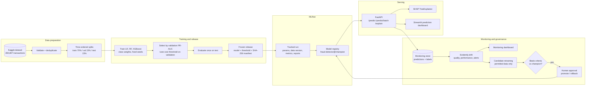
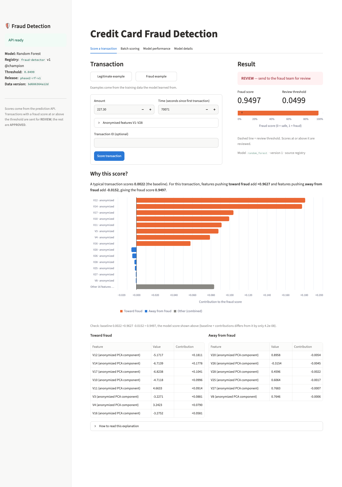
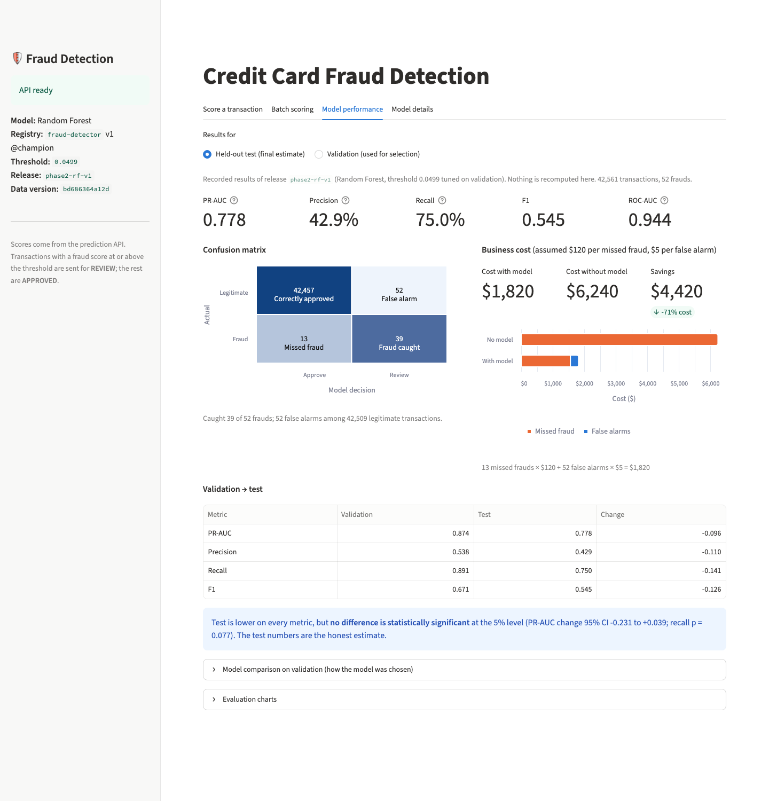
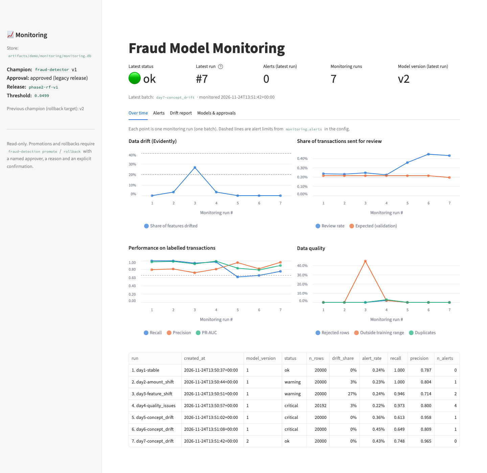
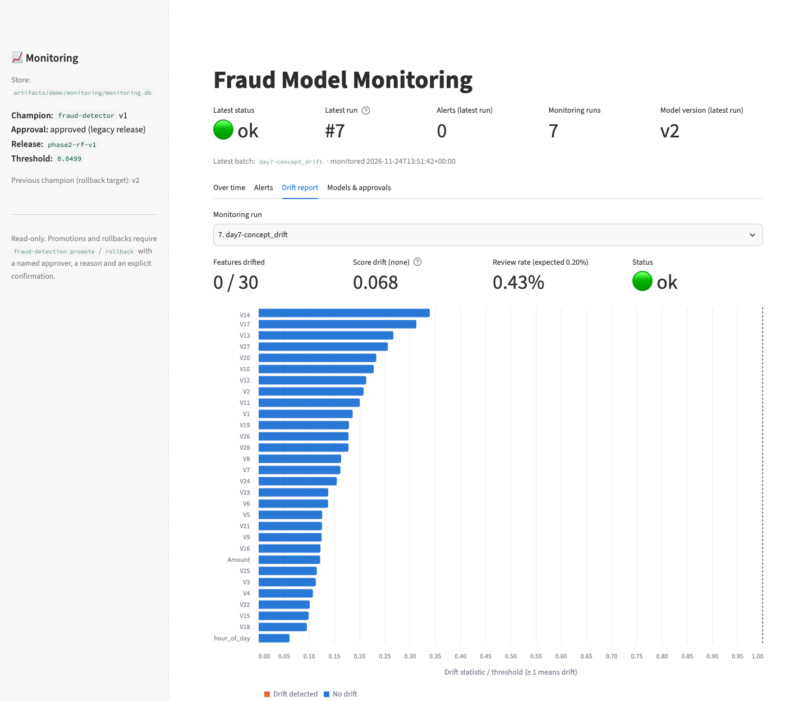
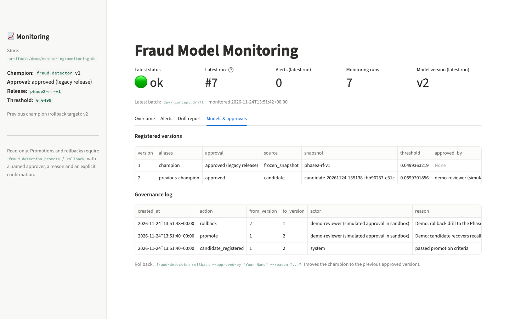
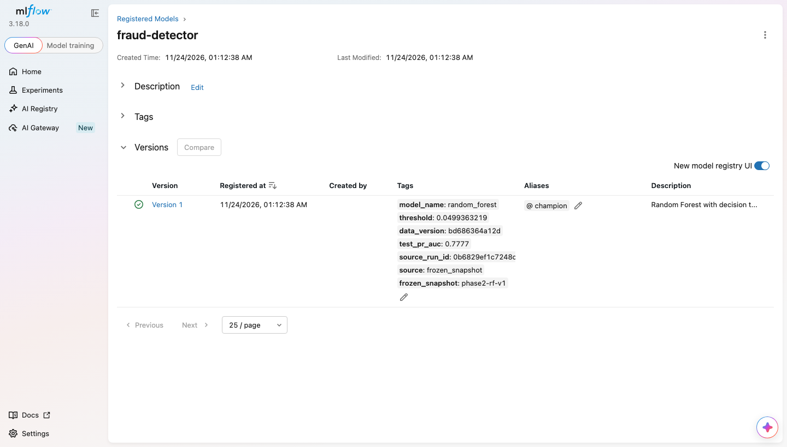
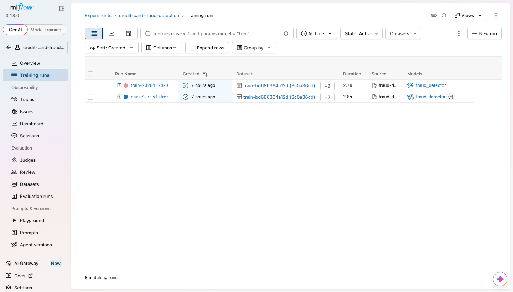

# End-to-End Credit Card Fraud Detection with MLOps

A production-style fraud detection system built around a real public dataset: leakage-safe data
preparation, imbalance-aware model selection, a cost-tuned decision threshold, MLflow model
registry with an approved **champion**, a FastAPI service, a Streamlit dashboard with **SHAP**
explanations, **Evidently** drift monitoring, and a **controlled retraining** workflow with
human approval and rollback. Everything runs locally and for free, with or without Docker.


---

## Contents

[Highlights](#highlights) · [Results](#results-frozen-held-out-test-set) ·
[Architecture](#architecture) · [Screenshots](#screenshots) · [Tech stack](#tech-stack) ·
[Quick start](#quick-start) · [Docker](#run-with-docker) · [How it works](#how-it-works) ·
[Reproducibility](#reproducibility) · [Testing](#testing) · [Limitations](#limitations) ·
[Project structure](#project-structure) · [Further reading](#further-reading)

## Highlights

| Area | What is implemented |
|---|---|
| **Data** | Validated loading of the 284,807-transaction Kaggle dataset, duplicate removal, **time-ordered** train / validation / test splits (no future leakage), automated data checks |
| **Modelling** | Logistic Regression, Random Forest and XGBoost with training-only class weights; selection by validation **PR-AUC**; decision threshold tuned on validation by **expected business cost** |
| **Evaluation** | Held-out test set used **once**; bootstrap confidence intervals; documented validation → test drop with significance tests |
| **Model registry** | Frozen, checksummed release; MLflow tracking (params, data version, metrics, artifacts); registered as `fraud-detector@champion` |
| **Serving** | FastAPI with strict input validation, single + batch scoring, health/readiness checks; refuses to serve any model that is not the approved, checksum-verified release |
| **Explainability** | Per-transaction **SHAP** (TreeSHAP) contributions in probability space that add up exactly to the displayed score; anonymized features labelled honestly |
| **Dashboards** | Streamlit prediction dashboard (scoring, batch upload, performance, explanations) and a monitoring dashboard |
| **Monitoring** | Prediction capture, **Evidently** feature and score drift, data quality, review rate, performance once labels arrive, configurable alerts |
| **Retraining** | Reproducible candidates from permitted data only (**never** the test set), promotion criteria vs the champion, **explicit human approval**, one-command **rollback**, full audit trail |
| **Engineering** | Modular package + CLI, typed config, 252 automated tests, Docker Compose with persistent volumes, fresh-clone bootstrap |

## Results (frozen held-out test set)

The champion is a **Random Forest** (300 trees, `class_weight="balanced_subsample"`), selected by
validation PR-AUC. Its decision threshold, **0.0499**, minimises the validation cost of
`$120 × missed fraud + $5 × false alarm` (illustrative business costs). These are the frozen
release's results on the newest 15% of transactions, which were never used for any decision:

| Metric | Test result | 95% bootstrap CI |
|---|---:|---|
| **PR-AUC** | **0.778** | 0.668 – 0.876 |
| **Precision** | **0.429** | 0.333 – 0.538 |
| **Recall** | **0.750** | 0.631 – 0.860 |
| **F1** | **0.545** | — |
| ROC-AUC | 0.944 | 0.896 – 0.984 |

| | Predicted legitimate | Predicted fraud |
|---|---:|---:|
| **Actual legitimate** (42,509) | 42,457 | 52 false alarms |
| **Actual fraud** (52) | 13 missed | **39 caught** |

* Fraud is 0.12% of the test period, so a random model scores PR-AUC ≈ 0.001.
* The model catches **3 in 4 frauds**; **43%** of alerts are genuine fraud; only **0.12%** of
  legitimate customers are flagged.
* Under the assumed costs: **$1,820** with the model vs **$6,240** without (**−71%**).

### Validation → test performance drop

| Metric | Validation | Test | Change |
|---|---:|---:|---:|
| PR-AUC | 0.874 | 0.778 | −0.096 |
| Precision | 0.538 | 0.429 | −0.110 |
| Recall | 0.891 (49/55) | 0.750 (39/52) | −0.141 |
| F1 | 0.671 | 0.545 | −0.126 |

Every metric is lower on test, consistently: test PR-AUC is below validation in 92% of bootstrap
resamples. But **no difference is statistically significant at 5%**: the PR-AUC change has a 95%
CI of −0.231 to +0.039, and the recall Fisher test gives p = 0.077. The likely causes are
selection optimism (the model and threshold were chosen *because* they were best on
validation), time drift (test is the latest period), and small samples (about 50 frauds per
split). **The test numbers are the honest estimate.** The threshold was not re-tuned after
seeing them. Full analysis: [`docs/phase2_results.md`](docs/phase2_results.md).

<details>
<summary>Model comparison on validation (how the champion was chosen)</summary>

| Model | PR-AUC (95% CI) | Threshold | Precision | Recall | False alarms | Cost |
|---|---|---:|---:|---:|---:|---:|
| Logistic Regression | 0.809 (0.711–0.893) | 0.996 | 0.457 | 0.873 | 57 | $1,125 |
| **Random Forest** ✓ | **0.874** (0.782–0.950) | 0.050 | 0.538 | 0.891 | 42 | **$930** |
| XGBoost | 0.840 (0.744–0.924) | 0.193 | 0.378 | 0.873 | 79 | $1,235 |

</details>

## Architecture



## Screenshots

**Prediction dashboard: score, decision and SHAP explanation**



<table>
<tr>
<td width="50%"><b>Recorded test performance</b><br/></td>
<td width="50%"><b>Monitoring over time (synthetic demo batches)</b><br/></td>
</tr>
<tr>
<td><b>Per-feature drift (Evidently)</b><br/></td>
<td><b>Model versions and approval log</b><br/></td>
</tr>
<tr>
<td><b>MLflow registry: champion alias</b><br/></td>
<td><b>MLflow tracked runs</b><br/></td>
</tr>
</table>

## Tech stack

| Layer | Tools |
|---|---|
| Language & data | Python 3.11, pandas 3, NumPy 2, PyArrow (Parquet) |
| Modelling | scikit-learn (pipelines, Logistic Regression, Random Forest), XGBoost |
| Experiment tracking & registry | MLflow 3 (local SQLite backend, model aliases) |
| Serving | FastAPI, Pydantic (strict validation), Uvicorn |
| UI | Streamlit, Altair |
| Explainability | SHAP (interventional TreeSHAP) |
| Monitoring | Evidently 0.7 (isolated environment), SQLite store |
| Quality | pytest (252 tests), ruff, Streamlit AppTest |
| Packaging | Docker, Docker Compose, Makefile, `fraud-detection` CLI |

## Quick start

**Requirements:** Python 3.11, about 3 GB of free disk space, and on macOS `brew install libomp`
(needed by XGBoost).

```bash
git clone https://github.com/bhumikapandey05/Fraud-Detection.git
cd Fraud-Detection

make setup            # .venv with all dependencies + the package (editable)
make monitoring-env   # isolated .venv-monitoring for Evidently (pandas < 3)
make bootstrap        # download data -> prepare -> train -> freeze -> register champion
```

`make bootstrap` downloads the public dataset, trains the three models with fixed seeds, freezes
the selected model as release `phase2-rf-v1`, and registers it as `fraud-detector@champion`
(about 2 minutes). It is idempotent: if the release already exists, it is only verified and
registered, never retrained or replaced. Use `fraud-detection bootstrap --source kaggle` to
download through the Kaggle API instead of the public mirror.

Then run the apps (one terminal each):

```bash
make api                    # FastAPI         http://127.0.0.1:8000   (docs: /docs)
make dashboard              # prediction UI   http://127.0.0.1:8501
make monitoring-dashboard   # monitoring UI   http://127.0.0.1:8502
make mlflow-ui              # MLflow UI       http://127.0.0.1:5000
```

Try the API:

```bash
curl -s http://127.0.0.1:8000/health/ready
curl -s -X POST http://127.0.0.1:8000/predict -H "Content-Type: application/json" \
  -d '{"Time": 406, "Amount": 0.0, "V1": -2.31, "V2": 1.95, "V3": -1.61, "V4": 4.0,
       "V5": -0.52, "V6": -1.43, "V7": -2.54, "V8": 1.39, "V9": -2.77, "V10": -2.77,
       "V11": 3.20, "V12": -2.90, "V13": -0.60, "V14": -4.29, "V15": 0.39, "V16": -1.14,
       "V17": -2.83, "V18": -0.02, "V19": 0.42, "V20": 0.13, "V21": 0.52, "V22": -0.04,
       "V23": -0.47, "V24": 0.32, "V25": 0.04, "V26": 0.18, "V27": 0.26, "V28": -0.14}'
# -> {"fraud_score": 0.9464, "decision": "REVIEW", "model": {"version": "1", "threshold": 0.0499, ...}}
```

### Command reference

| Task | Command |
|---|---|
| Full monitoring → retraining → approval → rollback demo (sandbox) | `make monitoring-demo` then `make demo-dashboard` |
| Monitor the latest batch of captured traffic | `fraud-detection monitor` |
| Attach confirmed outcomes | `fraud-detection add-labels --file labels.csv` |
| Train and compare a candidate | `fraud-detection retrain-candidate` |
| Promote an eligible candidate | `fraud-detection promote --version N --approved-by "Name" --reason "..."` |
| Roll back the champion | `fraud-detection rollback --approved-by "Name" --reason "..."` |
| Registry, approvals and audit log | `fraud-detection governance` |
| Verify the frozen release | `fraud-detection verify-frozen --name phase2-rf-v1` |
| All commands | `fraud-detection --help`, `make help` |

## Run with Docker

```bash
docker compose up --build -d     # first run: bootstrap (download + train + register), then serve
docker compose logs -f bootstrap # follow the one-time bootstrap (a few minutes)
```

| Service | URL | Purpose |
|---|---|---|
| `bootstrap` | — | one-shot: data → model → frozen release → champion (idempotent) |
| `api` | http://127.0.0.1:8000 | FastAPI (health-checked) |
| `dashboard` | http://127.0.0.1:8501 | prediction dashboard |
| `monitoring-dashboard` | http://127.0.0.1:8502 | monitoring dashboard |
| `mlflow` | http://127.0.0.1:5000 | MLflow UI |

* **Persistent storage:** named volumes for `data`, `artifacts`, `mlflow`, `monitoring`,
  `reports` and `logs`. `docker compose down` keeps them, and the next `up` reuses the
  registered champion without retraining. `docker compose down -v` resets everything.
* **Local only:** ports bind to `127.0.0.1`; change them with `API_PORT`, `DASHBOARD_PORT`,
  `MONITORING_PORT` or `MLFLOW_PORT`.
* **Evidently:** the image contains its own isolated Evidently environment, just like the
  local setup.
* **Separate from local runs:** the Docker stack has its own registry. Local and container
  MLflow stores are not shared, because MLflow records absolute artifact paths.

## How it works

<details>
<summary><b>Data preparation: leakage-safe, time-ordered splits</b></summary>

* The 284,807 transactions are validated against 13 schema and value checks. 1,081 exact
  duplicates are removed before splitting, so no transaction appears in two splits.
* The split is by **time**: train is the oldest 70% (366 frauds), validation the next 15% (55),
  and test the newest 15% (52). Cut-offs are timestamps, so `max(train.Time) < min(val.Time)`.
* Preprocessing is a scikit-learn `ColumnTransformer` fitted on **train only**:
  - V1–V28 are robust-scaled;
  - `Amount` is log-transformed, then scaled;
  - `Time` becomes cyclical hour-of-day features.
* 61 pre-training checks re-verify counts, schema and leakage from the saved files.

</details>

<details>
<summary><b>Modelling, threshold and one-time test evaluation</b></summary>

* **Imbalance:** handled with class weights computed from training labels. There is no
  resampling, and validation and test are never reweighted.
* **Selection metric:** validation **PR-AUC**. ROC-AUC is reported but is dominated by easy
  negatives at a 0.17% fraud rate.
* **Threshold:** each model's threshold minimises `120·FN + 5·FP` on **validation**. The
  default 0.5 is arbitrary: at 0.5, Logistic Regression raises 2,721 false alarms, and the
  Random Forest misses 29% of fraud.
* **Test:** only the selected model is scored on the test split, exactly once. A test asserts
  this.

</details>

<details>
<summary><b>MLflow tracking, model registration and the champion alias</b></summary>

* **Freezing:** the selected model is frozen into `artifacts/frozen/phase2-rf-v1/`, read-only. It
  holds the preprocessing + model pipeline with its threshold, metadata, reports, config and a
  SHA-256 `MANIFEST.json`. `verify-frozen` re-checks the checksums, confirms the data is
  byte-identical, and reproduces the recorded test metrics.
* **Tracking:** an MLflow run records the parameters (split, preprocessing, threshold rule,
  hyperparameters) and a **data version** (a hash of the exact split files). It also records
  validation and test metrics with confidence intervals, the train/validation/test datasets, all
  reports and figures, and one child run per candidate model, for side-by-side comparison.
* **Registered model:** an MLflow **pyfunc** that wraps the pipeline *and* its tuned threshold,
  so `models:/fraud-detector@champion` returns the score and the decision. Serving can't fall
  back to 0.5 by accident.
* **Aliases, not stages:** the alias **`champion`** marks the version in use, and
  **`previous-champion`** is the rollback target. Aliases only move through explicit
  `promote` / `rollback` commands, never as a side effect of training.
* **Serving checks:** the API resolves `champion` at startup and serves it only if it is
  approved and its model file matches the frozen release's SHA-256. Otherwise it reports
  "not ready" (503) instead of guessing.

</details>

<details>
<summary><b>SHAP explainability</b></summary>

* `POST /explain` and the dashboard show, for one transaction, which fields pushed the fraud
  score up or down.
* **Same units as the score:** a Random Forest's probability is the mean of its trees, so
  TreeSHAP works directly in probability space. Every explanation is checked:
  `baseline + Σ contributions = displayed score` (to about 1e-7), otherwise it is refused.
* **Meaningful baseline:** the default SHAP baseline would be **0.5**, because the trees were
  trained with balanced class weights. Instead, interventional TreeSHAP with 500 seeded
  **training** transactions gives a baseline equal to the model's average real score (≈ 0.0022),
  i.e. "a typical transaction".
* **Per field:** contributions are summed back to the 30 input fields (`Time` = hour-of-day
  features). **V1–V28 are labelled as anonymized PCA components**, with no invented business
  meaning.
* **Safe failure:** explanations never block predictions. If they're unavailable, the dashboard
  says why and still shows the prediction.

</details>

<details>
<summary><b>Drift monitoring</b></summary>

* **Capture:** the API stores every scored transaction (features, score, decision, model
  version). A storage failure never fails a prediction. Batch files can be ingested, and
  confirmed fraud outcomes are attached later.
* **`fraud-detection monitor` compares:**
  - features with a training sample (Evidently `DataDriftPreset` on hour of day, Amount and
    V1–V28; raw `Time` always increases, so it isn't monitored);
  - fraud scores with the champion's validation scores;
  - the review rate with the expected rate;
  - data quality (rejected, out-of-range and duplicate rows);
  - recall, precision and PR-AUC once at least 20 labelled frauds are available.
* **Alerts:** configurable thresholds (`monitoring.alerts`), including "watched" key features
  and a recall floor of 0.65, around the lower end of the champion's test recall interval.
* **Outputs:** Evidently HTML reports, a stored summary, an MLflow run, and the monitoring
  dashboard.
* **Isolated environment:** Evidently 0.7 doesn't support pandas 3, so it runs in an isolated
  environment and is called as a subprocess. The model's environment stays unchanged.

</details>

<details>
<summary><b>Controlled retraining, approval and rollback</b></summary>

* **Permitted data:** the training split plus labelled production transactions. The newest 30%
  of labelled rows are held out for comparison, and the validation split is never trained on.
* **Test set guard:** the test split is **never read**. It is refused by name and by checksum,
  and a test asserts `test.parquet` is never opened during retraining.
* **Same recipe:** the candidate reuses the champion's exact frozen recipe (preprocessing,
  hyperparameters, seed, cost-based threshold rule); only the data changes. It is reproducible
  and stored as a read-only snapshot with a comparison report.
* **Promotion criteria:** no worse than the champion on validation (PR-AUC −0.01, recall
  −0.05, cost +10%) and at least as good on the recent holdout. Eligible candidates are
  registered as **pending**, with no alias.
* **Promotion:** `promote` requires a named approver, a reason, and typing the version number to
  confirm. It then moves `champion` and sets `previous-champion`.
* **Rollback:** `rollback` returns `champion` to an approved version, with the same safeguards.
* **Audit trail:** every action is recorded as model-version tags, a run in the MLflow
  governance experiment, and a local event log.
* **Demo:** `make monitoring-demo` runs the whole lifecycle on synthetic batches in an isolated
  sandbox:
  - alerts for amount shift, feature drift, data-quality problems and concept drift
    (recall 1.00 → 0.61);
  - an eligible candidate (recent-holdout PR-AUC 0.874 vs 0.792) promoted with a *simulated*
    approval, which brings recall back to 0.75;
  - a rollback drill back to v1.

  The real registry is untouched. Batches are generated from training rows, so the demo shows
  mechanics, not real-world accuracy.

</details>

## Reproducibility

* **Fixed seeds and verified inputs:** every step is seeded, and inputs are checked against
  SHA-256 hashes. On the same platform, a fresh clone + `make bootstrap` reproduces the same
  splits (byte-identical), model choice, threshold and metrics.
* **Across operating systems:** the multi-threaded tree models aren't bit-identical. Building in
  Docker (Linux) instead of macOS gives the same selected model, an essentially identical
  threshold (0.04993 vs 0.04994), and **identical test precision, recall, F1 and confusion
  matrix**. Ranking metrics differ by up to ≈ 0.002 (test PR-AUC 0.7787 vs 0.7777).
* **Pinned environment:** dependencies are pinned in `requirements*.txt`, and every model's
  metadata records the library versions it was trained with.
* **Not in Git:** the dataset, processed splits, trained models, MLflow store and monitoring
  data are all regenerated by `make bootstrap` or the Docker bootstrap.

## Testing

```bash
make test                         # 252 tests with coverage (~1 min)
pytest -m "not integration"       # skip tests that need the real dataset
```

| Area | What the tests check |
|---|---|
| Data | Validation rules, leakage, time order, split sizes, preprocessing fitted on train only |
| Modelling | Threshold search vs brute force, metrics, reproducibility, test set scored exactly once |
| Releases & MLflow | Frozen snapshot integrity, registry tags, idempotent registration |
| Serving | API validation (18 kinds of invalid input), fail-closed startup, identical scores to the frozen model, auto mode following promotions |
| SHAP | Additivity, baseline, per-field mapping, anonymized labels |
| Monitoring | Alert rules, Evidently end-to-end, prediction capture |
| Retraining | Test split never read, reproducible candidates, approval / promote / rollback refusals |
| Dashboards | Rendered with Streamlit `AppTest`, including graceful failure paths |

Unit tests use a small synthetic dataset, so they run without downloading anything. Tests that
need the real dataset or the Evidently environment skip themselves when those are missing.

## Limitations

* **Small, old, anonymized dataset:** two days of European card transactions from 2013, with
  only about 50 frauds in each of validation and test. Metrics have wide confidence intervals,
  and the model ranking (RF vs XGBoost) is not statistically certain.
* **Anonymized features:** V1–V28 are PCA components, so explanations can't be mapped to
  business concepts.
* **Assumed costs:** the $120 / $5 costs are illustrative. Real deployments should use
  fraud-operations figures, and the threshold moves with them.
* **Default hyperparameters:** sensible defaults, not tuned; tuning would use time-series
  cross-validation on the training data.
* **Labels assumed complete:** monitoring treats labels as eventually available and correct.
  Real chargebacks arrive late and incomplete.
* **Local only:** no authentication, scheduling or alert delivery. Monitoring runs on demand,
  and the API picks up a new champion on restart.
* **Cross-platform drift:** results are bit-reproducible on one platform but differ slightly
  across operating systems (see [Reproducibility](#reproducibility)).

## Project structure

```
├── configs/config.yaml       # all settings: paths, splits, models, costs, serving, monitoring
├── src/fraud_detection/
│   ├── data/                 # download, loading, validation, cleaning, splits, verification
│   ├── features/             # preprocessing pipeline + custom transformers
│   ├── models/               # model factory, metrics, threshold tuning, FraudDetector
│   ├── pipelines/            # prepare, train, evaluate, freeze, track, monitor, demo, bootstrap
│   ├── tracking/             # MLflow logging + pyfunc wrapper (model + threshold)
│   ├── serving/              # FastAPI app, schemas, approved-model loader, reports
│   ├── explainability/       # SHAP explainer
│   ├── monitoring/           # store, Evidently bridge + runner, quality, alerts, simulator
│   ├── retraining/           # permitted data, candidates, criteria, approval, governance
│   ├── dashboard/            # Streamlit prediction + monitoring dashboards
│   └── cli.py                # `fraud-detection` command
├── tests/                    # 252 tests
├── docs/                     # design decisions, frozen results, detailed guide, screenshots
├── Dockerfile, docker-compose.yml, Makefile
└── requirements*.txt         # pinned dependencies (main + isolated monitoring env)
```

## Further reading

* [`docs/phase2_results.md`](docs/phase2_results.md): the frozen release's results and the
  validation → test analysis
* [`docs/design_decisions.md`](docs/design_decisions.md): 50 design decisions and the reasoning
  behind them
* [`docs/detailed_guide.md`](docs/detailed_guide.md): phase-by-phase guide to every command
  and component

## Dataset

[Credit Card Fraud Detection](https://www.kaggle.com/datasets/mlg-ulb/creditcardfraud) by the
Machine Learning Group of ULB (Université Libre de Bruxelles) and Worldline. The data is
**not** included in this repository; it is downloaded by `make bootstrap`. Please refer to the
dataset page for its license and citation.
